# Manual de Integración por Grupos

## Universidad San Carlos de Guatemala

_Facultad de Ingeniería_  
_Escuela de Ciencias y Sistemas_  
_Curso:_ Estructuras de Datos  
_Proyecto:_ EDDMail Fase 1

---

## Integrantes del Grupo

- Gabriela Alejandra Brito Pérez — Carnet: 202300686
- Angel Jose Cardenas Pocon — Carnet: 202304063
- Oliverio Abraham Caal Artola — Carnet: 202303864

---

## Objetivo de la Integración

Desarrollar la funcionalidad de comunidades en EDDMail, permitiendo que el usuario root cree comunidades y asigne usuarios a ellas. Cada usuario puede pertenecer a varias comunidades y cada comunidad puede tener varios usuarios.

---

## Estructuras Utilizadas

- _Lista Simple:_ Para almacenar y administrar las comunidades.
- _Lista Simple:_ Para almacenar y administrar los usuarios.
- _Lista de listas:_ Para manejar las comunidades y los usuarios que pertenecen a cada una.

### Diagrama de la Estructura

[Estructura de Comunidades]
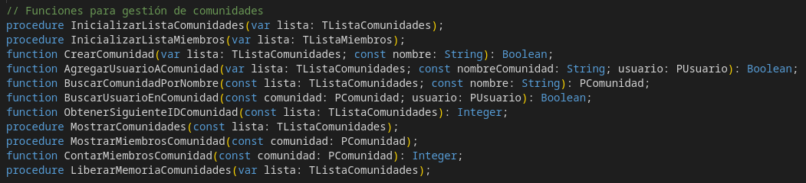

# Manual de Integración por Grupos

## Capturas de la Interfaz

### Creación de Comunidades

_Creación de Comunidad_

## 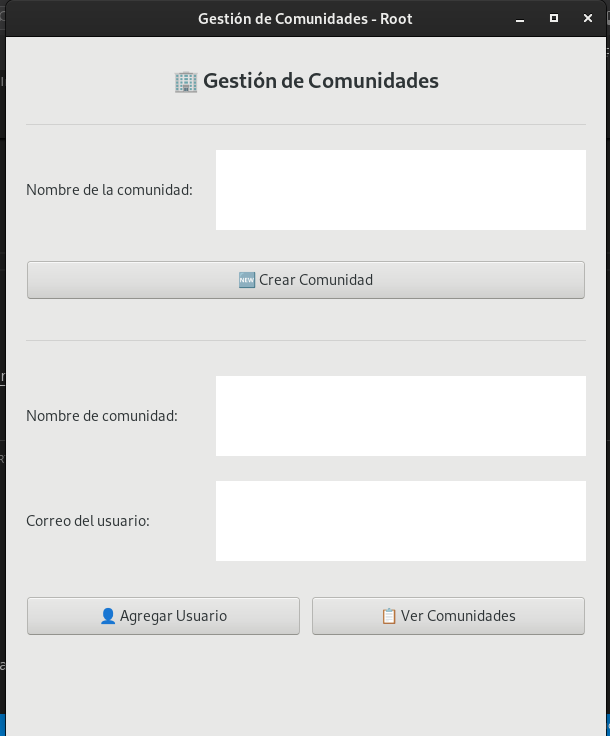

### Asignación de Usuarios a Comunidad

_Asignar Usuario a Comunidad_

![Asignar Usuario a Comunidad]
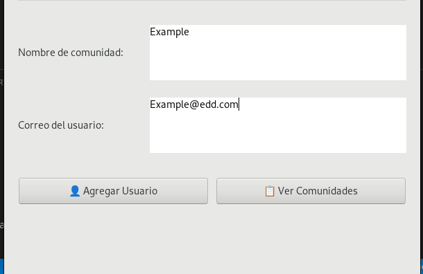

---

## Reporte de Comunidades

El sistema genera un reporte gráfico de las comunidades y sus miembros usando Graphviz.

_Reporte de Comunidades_

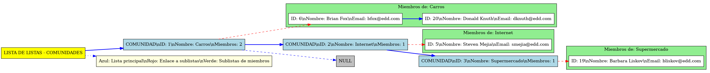

---

## Integración en Cada Proyecto

### Alejandra Barrios

_Descripción:_  
Realizo la estructura de comunidades usando una lista simple de comunidades y una lista simple de miembros por comunidad. El usuario root puede crear comunidades y asignar usuarios desde la interfaz gráfica mas la adaptacion del codigo para su propio proyecto.
_Captura:_
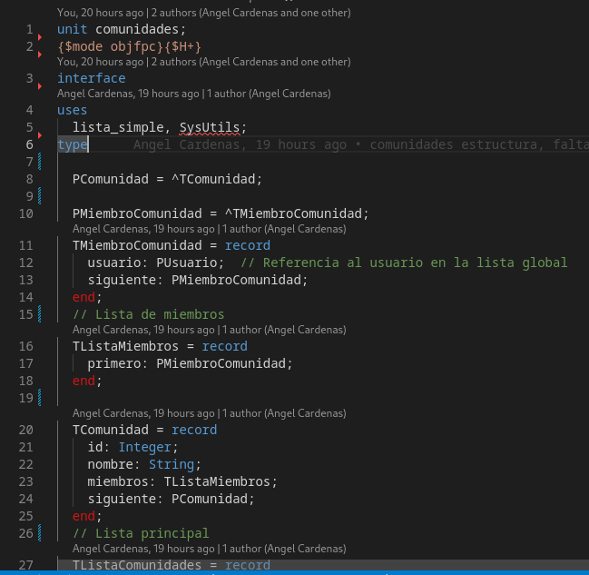
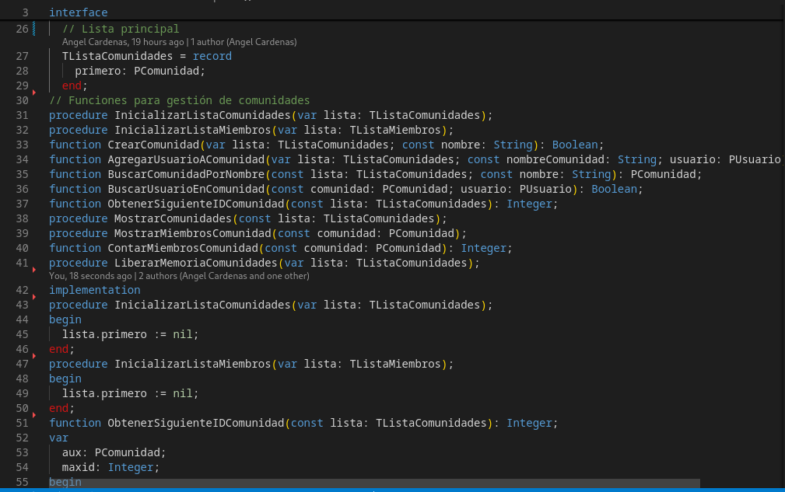
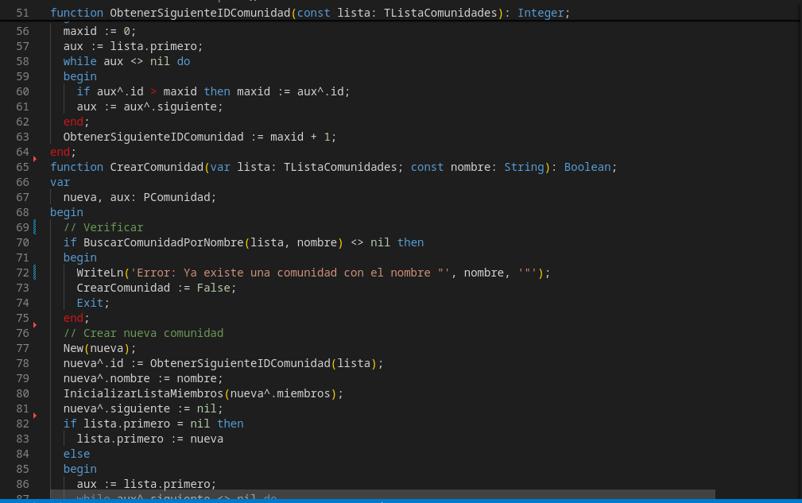
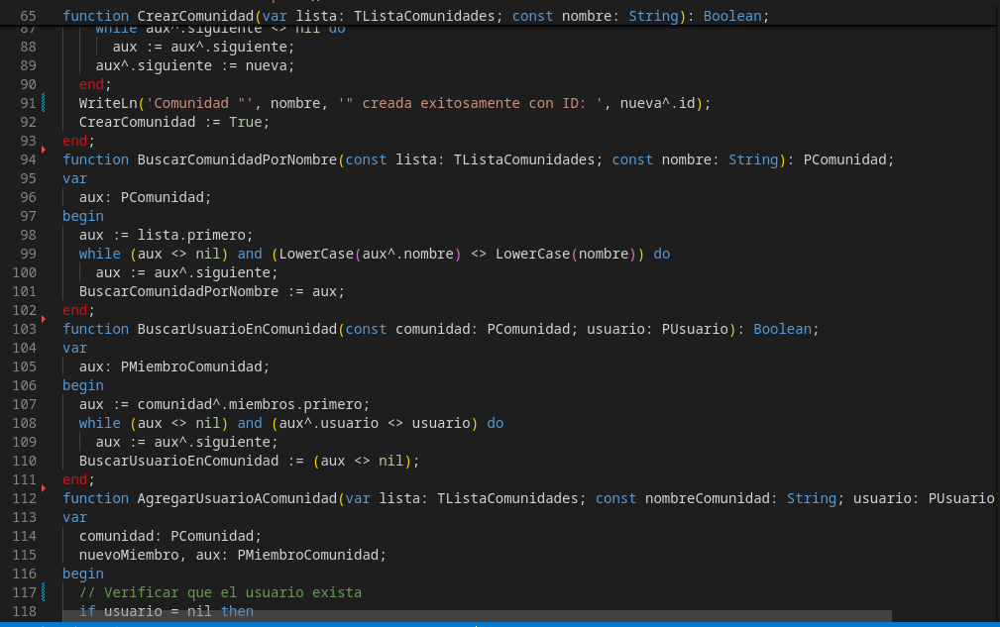
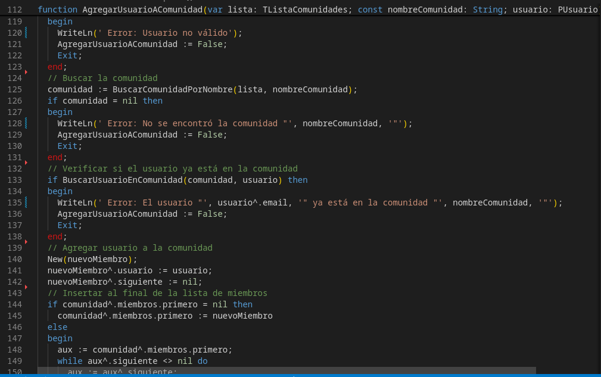
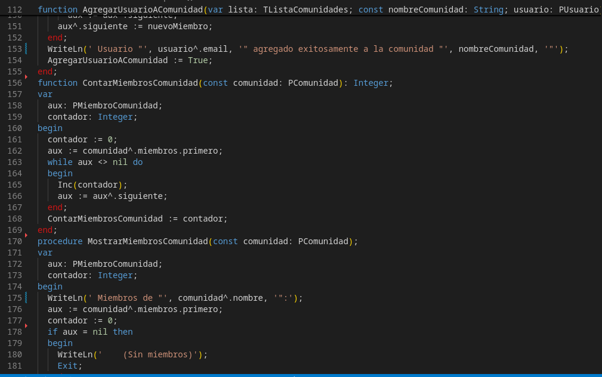
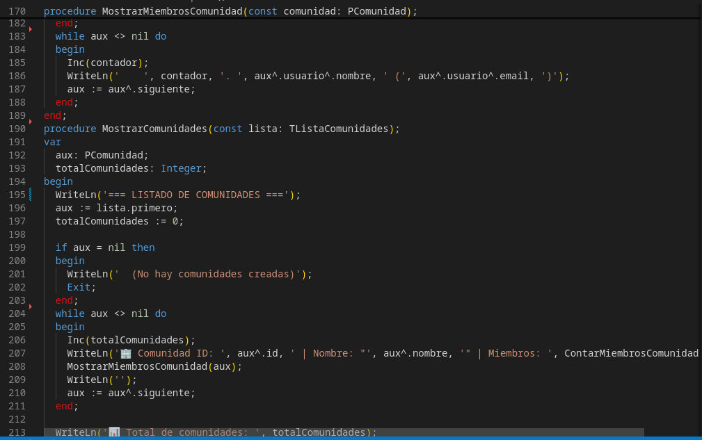
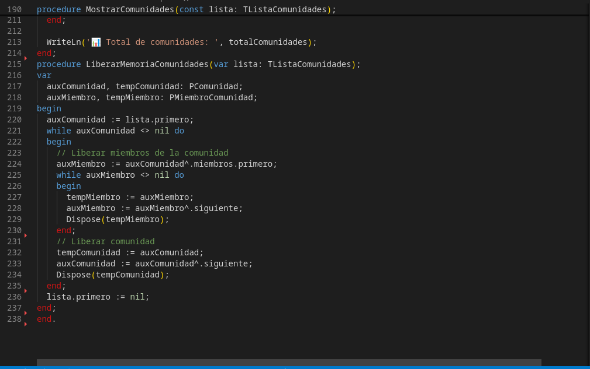

---

### Angel Cardenas

_Descripción:_  
Se creo un diagrama de clases para poder apoyarse en el codigo en Object Pascal y poder programarlo adecuadamente mas la adaptacion del codigo para su propio proyecto.

_Captura:_  
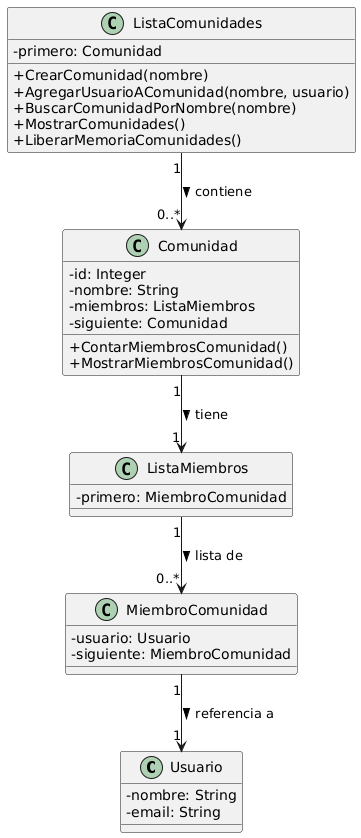

### Oliverio Caal

_Descripción:_  
La realizacion de la interfaz sumado a parte del codigo final de la estructura, mas la adaptacion de el codigo para su propio proyecto

_Captura:_
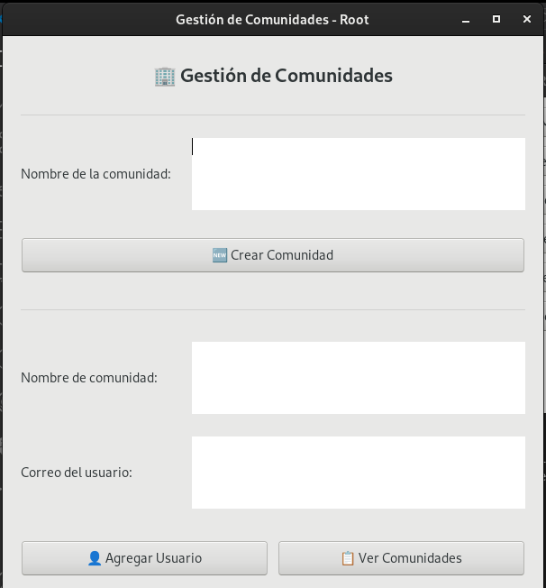
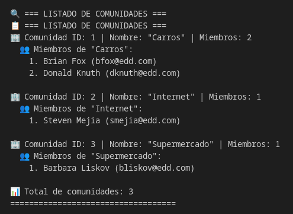

## Observaciones

- La integración se realizó utilizando _punteros_ y estructuras dinámicas en Object Pascal.
- El usuario root tiene privilegios para gestionar comunidades y asignar usuarios.
- Los reportes se generan en formato gráfico y se almacenan en la carpeta correspondiente.
- Las capturas muestran la estructura y la integración en cada proyecto individual.
- El sistema cumple con los requisitos del enunciado y la integración por grupos.
