## UNIVERSIDAD DE SAN CARLOS DE GUATEMALA

### FACULTAD DE INGENIERÍA

#### ESTRUCTURAS DE DATOS

#### CATEDRÁTICO: Ing. Alvaro Obrayan Hernandez

#### TUTOR ACADÉMICO: Luis Enrique Garcia

#### Angel José Cardenas Pocón

#### CARNÉ: 202304063

#### SECCIÓN: B

#### Guatemala, 3 de septiembre del 2025

# Manual de Usuario

## Introduccion

EDDMail es un sistema de simulación de correos electrónicos diseñado con fines académicos para la práctica de estructuras de datos dinámicas en Object Pascal, utilizando GTK como librería de interfaz gráfica.

El sistema permite la gestión completa de usuarios, envío y recepción de correos, programación de mensajes, administración de contactos y generación de reportes, todo soportado en estructuras como listas, colas, pilas y matrices dispersas.

## Objetivos

### Objetivo General

Implementar un sistema de simulación de correos electrónicos que integre diversas estructuras de datos dinámicas en un entorno gráfico, con el fin de administrar usuarios, correos y contactos de manera eficiente.

### Objetivos Específicos

- Diseñar e implementar una lista simple para el registro de usuarios.

- Utilizar una lista doblemente enlazada para la gestión de correos electrónicos recibidos.

- Implementar una lista circular para representar y recorrer los contactos de cada usuario.

- Emplear una cola para la administración de correos programados (FIFO).

- Incorporar una pila para almacenar y gestionar los correos eliminados.

- Construir una matriz dispersa que permita la visualización de relaciones entre emisores y receptores.

- Integrar una interfaz gráfica (GTK) que permita la interacción visual con las estructuras de datos y operaciones del sistema.

- Permitir al usuario root ejecutar operaciones avanzadas: carga masiva desde JSON y generación de reportes.

# Requisitos

### Requisitos de Hardware

Procesador: mínimo 1.5 GHz (recomendado 2.0 GHz o superior).

Memoria RAM: 2 GB mínimo (recomendado 4 GB o superior).

Almacenamiento: 500 MB de espacio disponible.

Pantalla: resolución mínima 1024x768.

### Requisitos de Software

Sistema Operativo: Linux (distribución libre).

Lenguaje de programación: Object Pascal.

IDE compatible: Lazarus o Free Pascal.

Librería gráfica: GTK.

Herramienta para gráficos y reportes: Graphviz.

Formato de integración de usuarios: Archivos JSON.

## Logica del programa

#### Carpeta

Fase 1 -> assets

- En esta carpeta se colocan los diferentes JSON para la prueba del programa en todo el transcurso de la creacion del mismo
  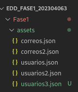

#### Carpeta

Fase 1 -> graficos

- Esta carpeta comprende todo el manejo y almacenamiento de los reportes, cada que se le da clic al boton de reportes depende de cada menu de usuario, se crean los reportes necesarios para esa misma visualizacion

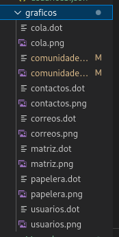

#### Carpeta

Fase 1 -> src -> estructuras

🔹 cola.pas, cola.o, cola.ppu

Rol en el sistema:
Implementa la cola (FIFO) para almacenar correos programados.

Lógica:

Los correos se encolan según la fecha/hora programada.

Se desencolan automáticamente cuando corresponde enviarlos.

🔹 comunidad.pas, comunidad.o, comunidad.ppu

Rol en el sistema:
Maneja las comunidades de usuarios, que agrupan varios usuarios en grupos definidos por el root.

Lógica:

Usa listas simples anidadas (lista de comunidades → lista de usuarios).

Permite asignar usuarios a comunidades ya creadas.

Da soporte a la integración grupal.

🔹 lista_circular.pas, lista_circular.o, lista_circular.ppu

Rol en el sistema:
Implementa la lista circular de contactos.

Lógica:

Cada usuario tiene su propia lista circular de contactos.

Permite recorrer los contactos en un ciclo sin fin (cuando llega al último, vuelve al primero).

La navegación es más eficiente que una lista lineal para contactos.

🔹 lista_doble.pas, lista_doble.o, lista_doble.ppu

Rol en el sistema:
Implementa la lista doblemente enlazada de correos en la bandeja de entrada.

Lógica:

Cada correo contiene datos: ID, remitente, asunto, estado, fecha, mensaje.

Se puede recorrer hacia adelante y atrás (ejemplo: pasar de un correo al siguiente o al anterior).

Soporta operaciones como: marcar como leído, eliminar (enviar a pila) y ordenar.

🔹 lista_simple.pas, lista_simple.o, lista_simple.ppu

Rol en el sistema:
Administra los usuarios registrados en el sistema.

Lógica:

Cada nodo representa un usuario (id, nombre, usuario, correo, teléfono).

Se insertan nuevos usuarios al registrarse o cargarse desde JSON.

El usuario root puede generar reportes a partir de esta lista.

🔹 matriz_dispersa.pas, matriz_dispersa.o, matriz_dispersa.ppu

Rol en el sistema:
Representa gráficamente la relación emisor ↔ receptor de correos.

Lógica:

Implementa una matriz dispersa (solo almacena celdas ocupadas).

Cada fila es un remitente, cada columna un destinatario.

Cada nodo registra el número de correos enviados.

Se puede graficar con Graphviz para visualizar conexiones.

🔹 pila.pas, pila.o, pila.ppu

Rol en el sistema:
Maneja la pila de correos eliminados.

Lógica:

Cuando un correo se borra de la bandeja de entrada, se apila en la papelera.

El usuario puede:

Buscar correos por palabra clave.

Eliminar definitivamente correos de la pila.

Estructura LIFO (el último eliminado es el primero en recuperarse o borrarse).

En conjunto, estos módulos conforman el núcleo lógico del programa:

- Usuarios → lista simple

- Correos → lista doble

- Contactos → lista circular

- Papelera → pila

- Correos programados → cola

- Relaciones emisor-receptor → matriz dispersa

- Comunidades → lista de listas (simple)

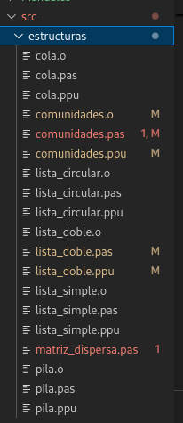

(algunos ejemplos de las estructuras)
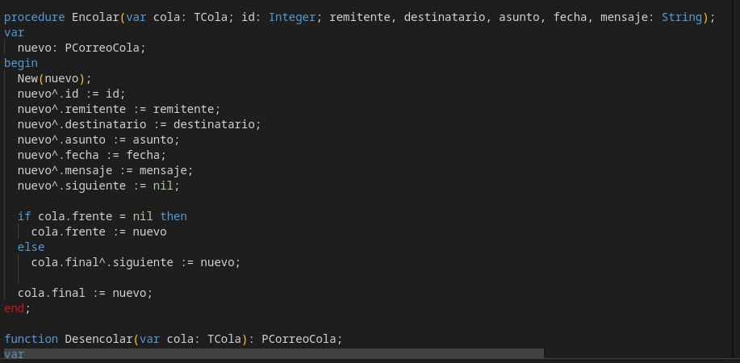
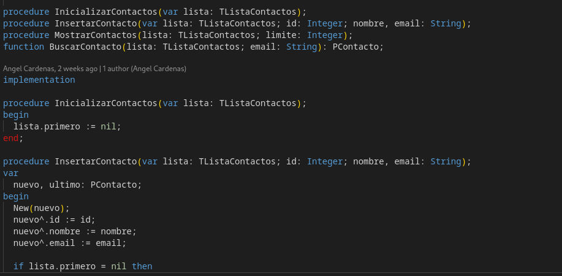
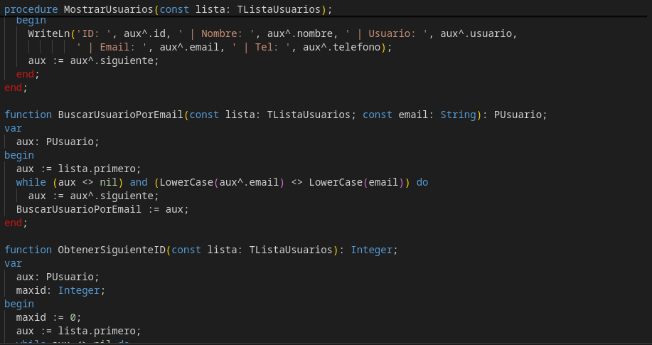

#### Carpeta

- Esta carpeta comprende la interfaz de todo el programa
  🔹 login.pas

Rol: Pantalla inicial del sistema.

Lógica:

Permite iniciar sesión con credenciales (usuario estándar o root).

También da la opción de registrar un nuevo usuario.

Valida datos contra la lista simple de usuarios.

🔹 menu_root.pas

Rol: Menú principal del usuario root.

Lógica:

Funcionalidades especiales:

Carga masiva de usuarios desde un JSON.

Generación de reportes (usuarios, relaciones).

Navegación hacia otras vistas de administración.

🔹 menu_usuario.pas

Rol: Menú principal de un usuario estándar.

Lógica:

Desde aquí el usuario puede acceder a:

Bandeja de entrada.

Papelera.

Redactar correo.

Programar correo.

Contactos.

Perfil.

Reportes.

🔹 registro_usuario.pas

Rol: Pantalla de registro.

Lógica:

Captura datos de nuevos usuarios (id, nombre, correo, teléfono).

Inserta el usuario en la lista simple.

Valida que no se repitan correos/usuarios.

🔹 perfil.pas

Rol: Interfaz para actualizar información del usuario.

Lógica:

Permite cambiar el nombre de usuario o número de teléfono.

Se actualizan los nodos correspondientes en la lista simple.

🔹 bandeja.pas

Rol: Bandeja de entrada del usuario.

Lógica:

Muestra correos de la lista doble.

Funciones:

Marcar correos como leídos.

Eliminar (se mandan a la pila de papelera).

Ordenar correos por asunto (A-Z).

Mostrar contador de no leídos.

🔹 enviados.pas

Rol: Historial de correos enviados.

Lógica:

Lista de correos que el usuario ha enviado a sus contactos.

Puede mostrarse en reportes.

🔹 redactar.pas

Rol: Ventana para escribir un correo.

Lógica:

Solo permite enviar correos a contactos existentes en la lista circular.

Valida que el destinatario esté agregado.

Inserta el correo en la bandeja del destinatario.

🔹 programar_correo.pas

Rol: Interfaz para programar correos.

Lógica:

Similar a redactar, pero con fecha/hora de envío.

Los correos se encolan en la cola.

Incluye botón para ejecutar el envío programado.

🔹 papelera.pas

Rol: Ventana de correos eliminados.

Lógica:

Muestra los correos almacenados en la pila.

Funciones:

Buscar por palabra clave.

Eliminar definitivamente (desapilar).

🔹 agregar_contacto.pas

Rol: Pantalla para añadir contactos.

Lógica:

Solicita el correo electrónico del contacto.

Inserta en la lista circular de contactos del usuario.

🔹 contacto.pas

Rol: Visualización de contactos individuales.

Lógica:

Permite recorrer los contactos uno por uno con botones de navegación.

🔹 comunidadesui.pas

Rol: Gestión de comunidades desde la vista de root.

Lógica:

Crear comunidades (listas simples).

Asignar usuarios a las comunidades.

Un usuario puede estar en varias.

🔹 reportes_ui.pas

Rol: Interfaz para generación y visualización de reportes.

Lógica:

Genera reportes en carpetas específicas (ej. usuario-reportes/).

Tipos:

Correos recibidos.

Papelera.

Correos programados.

Contactos.

Comunidades.

Relaciones remitente-destinatario (matriz dispersa).

- En conclusión, la carpeta ui/ contiene todas las pantallas gráficas, que funcionan como puentes entre el usuario y las estructuras de datos implementadas en la carpeta estructuras/.

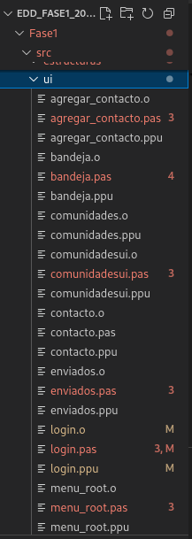
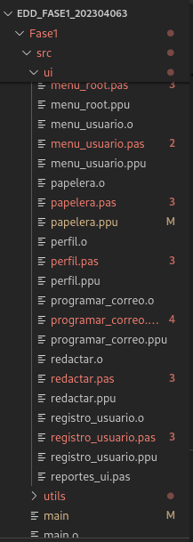

(algunos ejemplos de esta carpeta)

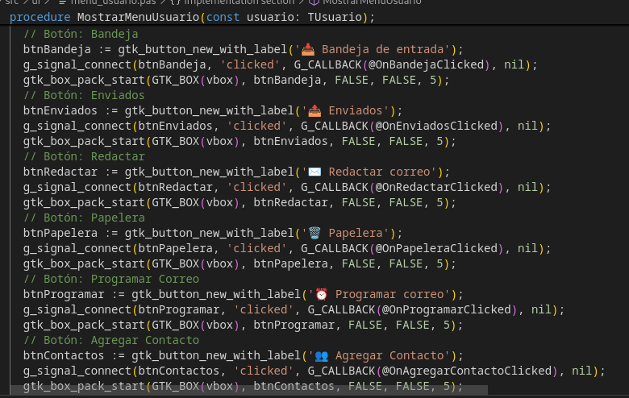
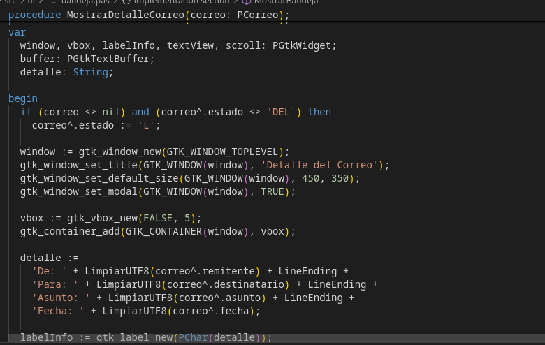
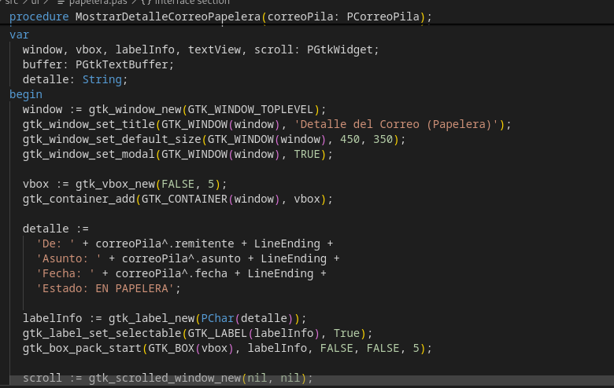

#### Carpeta

Fase 1 -> src -> utils
🔹 globals.pas

Rol: Definir variables y constantes globales.

Lógica:

Centraliza configuraciones generales del sistema.

Puede incluir rutas para reportes, credenciales de root (root@edd.com / root123) o banderas de control.

Facilita el acceso a parámetros compartidos entre diferentes módulos.

🔹 graphviz.pas

Rol: Generación de gráficos visuales mediante Graphviz.

Lógica:

Conecta estructuras de datos (listas, pilas, colas, matriz dispersa) con archivos DOT para representar gráficamente.

Ejemplos:

Graficar la matriz dispersa de relaciones remitente ↔ destinatario.

Visualizar usuarios, contactos o correos en estructuras enlazadas.

Exporta imágenes que se guardan en carpetas de reportes.

🔹 json_loader.pas

Rol: Módulo de lectura de archivos JSON.

Lógica:

Implementa la carga masiva de usuarios desde un archivo JSON.

Convierte la información en nodos de la lista simple de usuarios.

Es utilizado principalmente por el usuario root.

Valida campos como id, nombre, usuario, email, telefono.

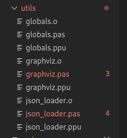

(algunos ejemplos de esta carpeta)
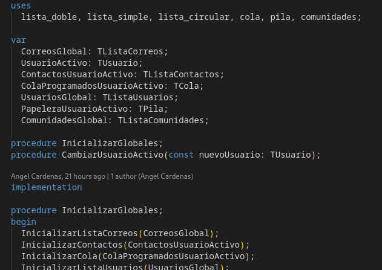
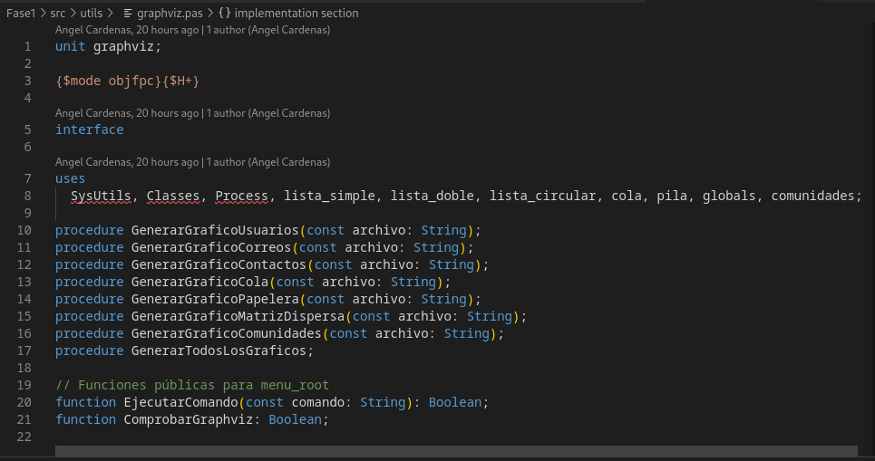
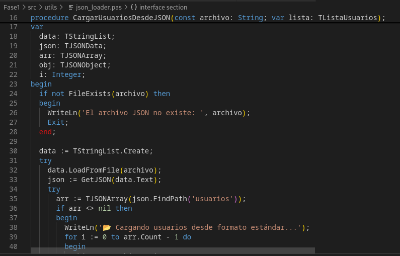

#### Metodo main

- Este archivo comprende lo primero que se ejecuta al compilar el programa, se inicializan todas las variables globales y luego se muestra la primera ventana que es la que inicia todo el programa, la ventana de login.
  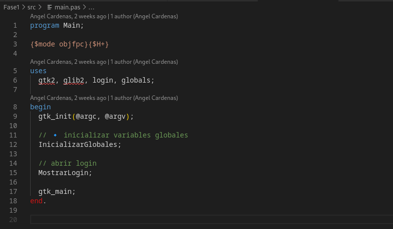
