# Manual de Integración por Grupos

## Universidad San Carlos de Guatemala

_Facultad de Ingeniería_  
_Escuela de Ciencias y Sistemas_  
_Curso:_ Estructuras de Datos  
_Proyecto:_ EDDMail Fase 2

---

## Integrantes del Grupo

- Gabriela Alejandra Brito Pérez — Carnet: 202300686
- Angel Jose Cardenas Pocon — Carnet: 202304063
- Oliverio Abraham Caal Artola — Carnet: 202303864

---

## Objetivo de la Integración

Desarrollar la funcionalidad de comunidades en EDDMail, permitiendo que el usuario root cree comunidades y asigne usuarios a ellas. Cada usuario puede pertenecer a varias comunidades y cada comunidad puede tener varios usuarios.

---

## Estructuras Utilizadas

- Árbol BST (Integración por grupo): Representará las comunidades creadas, ordenados por email o nombre para permitir búsquedas eficientes y navegación ordenada. Cada comunidad almacenara
  los siguientes datos: Nombre comunidad, Fecha creación, Número de mensajes publicados Se utilizará el atributo “Nombre comunidad” para realizar la inserción de las comunidades en el
  árbol.
- Árbol AVL: Gestionará los correos guardados como borradores que el usuario posteriormente
  podrá modificar y enviar al destinatario. Cada correo almacenará los siguientes datos:
  ○ ID
  ○ Remitente
  ○ Destinatario
  ○ Asunto
  ○ Mensaje
- Árbol B de Orden 5: Gestionará los correos favoritos de cada usuario, indexados por ID para
  búsquedas rápidas y manejo eficiente de grandes volúmenes, con nodos que soportan hasta 4
  claves y 5 hijos. Cada correo almacenará los siguientes datos:
  ○ ID
  ○ Remitente
  ○ Destinatario
  ○ Asunto
  ○ Mensaje
- Lista Simple: Se utilizará para almacenar y administrar los usuarios registrados en el sistema
  (primera fase)
- Cola: Almacenará los correos programados (primera fase)
- Pila: Gestionará los correos eliminados (primera fase)
- Matriz Dispersa: Visualizará las relaciones entre emisores y receptores (primera fase)

### Diagrama de la Estructura

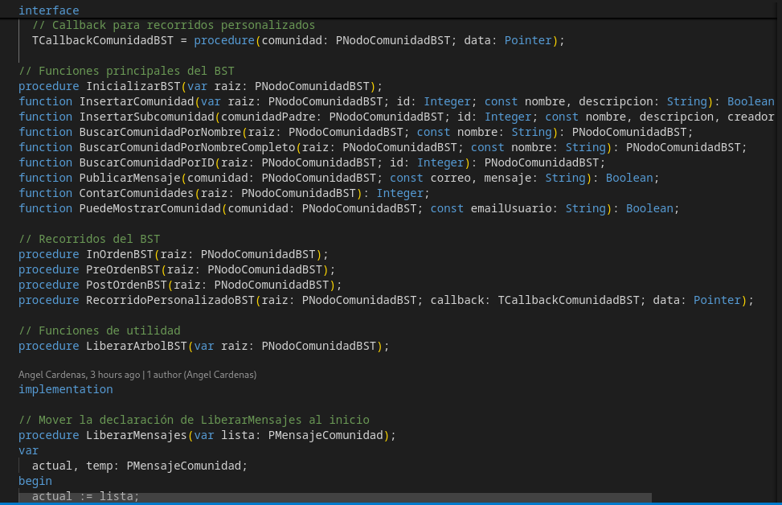
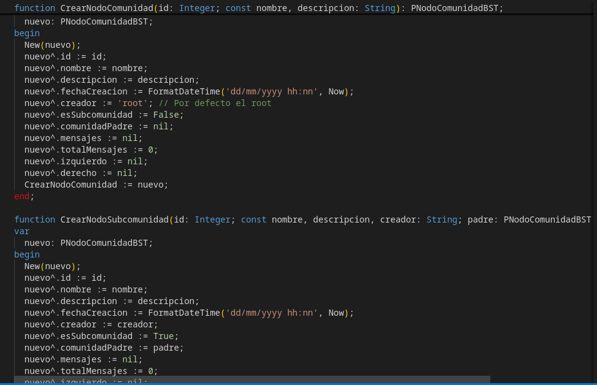
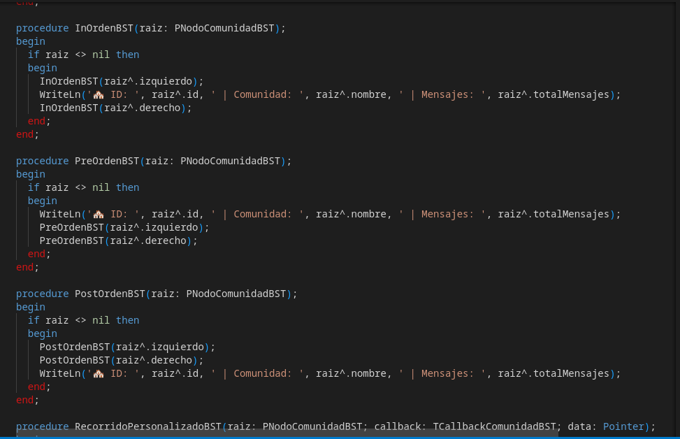

# Manual de Integración por Grupos

## Capturas de la Interfaz

### Creación de Comunidades

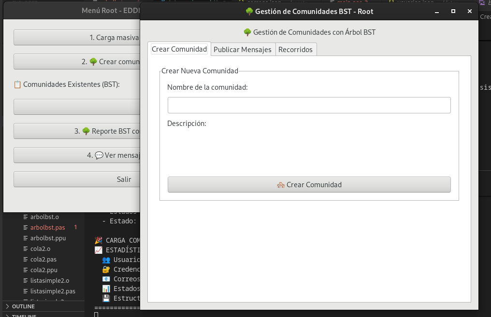

### Publicacion de mensajes y recorridos

### Reporte de BST de comunidades

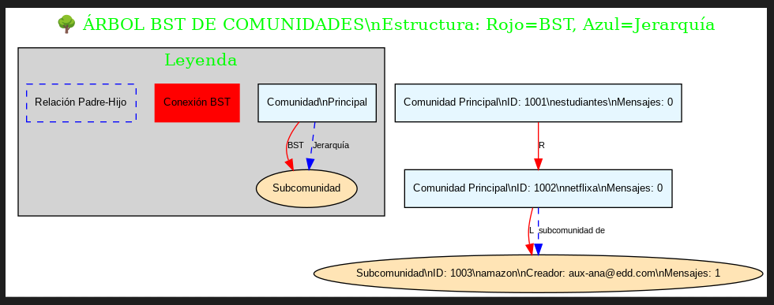

### Mensajes

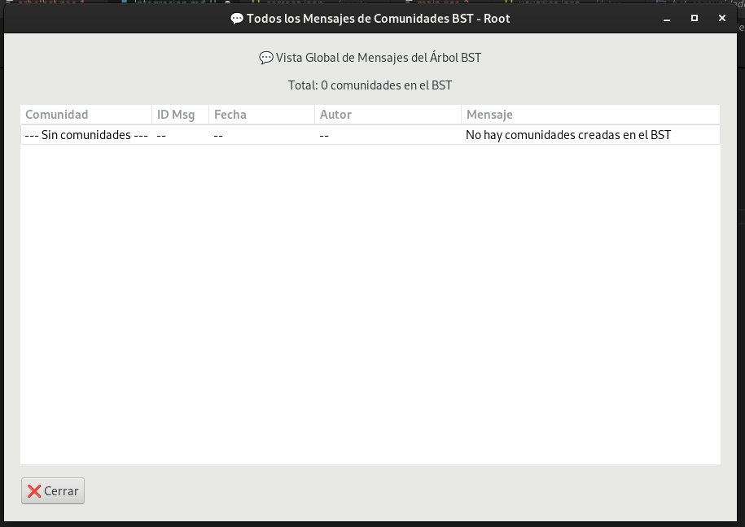

### Comunidades como usuario

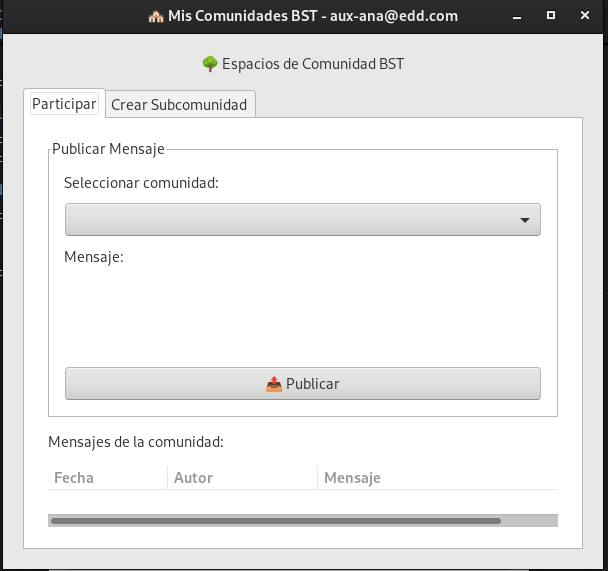

## Integración en Cada Proyecto

### Alejandra Barrios

_Descripción:_  
Realizo la parte de la interfaz tanto para el usuario root como para el usuario normal, aplicando todas las variables necesarias para poder aplicar la interfaz en los demas proyectos, botones para mensajes, tablas para los mensajes, y la aplicacion de los programas para su propio proyecto.
_Captura:_

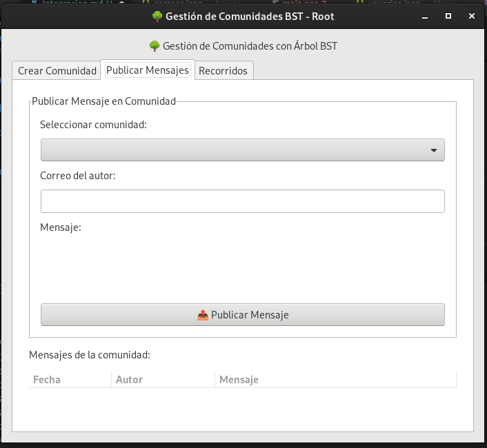

### Angel Cardenas

_Descripción:_  
Creo los recorridos del arbol BST, usando la logica necesaria tomada de la estructura para poder manejar los mensajes de las comunidades de una manera mas optima, y la generacion de reportes por medio de Graphviz, mas el manejo de los codigos de las interfaces y de la estructura para el propio proyecto
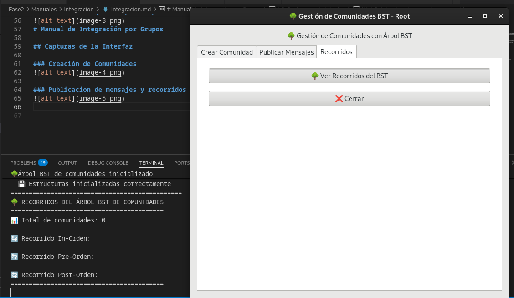

### Oliverio Caal

_Descripción:_  
Creo la estructura en general de la logica del arbol BST, todo lo relacionado a los nodos, raices, ramas, inducciones de datos, y manejo de informacion sobre los usuarios y listas para la generacion de reportes.
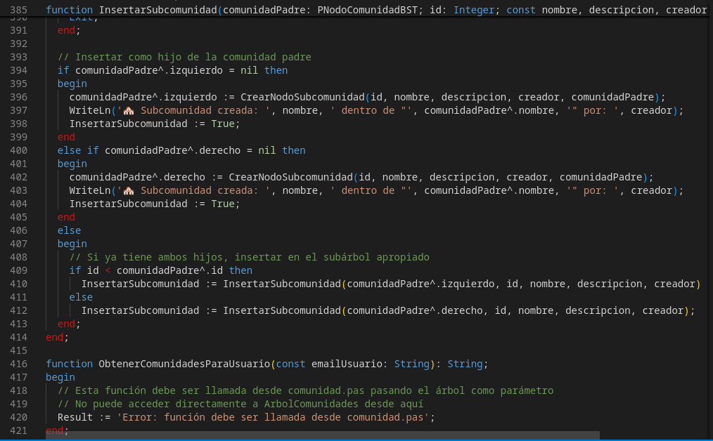

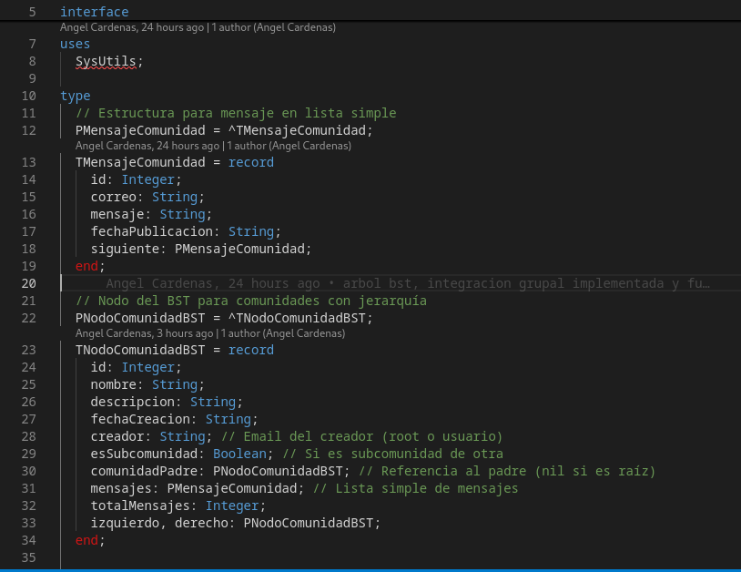

## Observaciones

- La integración se realizó utilizando el arbol BST y estructuras dinámicas en Object Pascal.
- El usuario root tiene privilegios para gestionar comunidades y realizar comentarios.
- Los reportes se generan en formato gráfico y se almacenan en la carpeta correspondiente.
- Las capturas muestran la estructura y la integración en cada proyecto individual.
- El sistema cumple con los requisitos del enunciado y la integración por grupos.
