## UNIVERSIDAD DE SAN CARLOS DE GUATEMALA

### FACULTAD DE INGENIERÍA

#### ESTRUCTURAS DE DATOS

#### CATEDRÁTICO: Ing. Alvaro Obrayan Hernandez

#### TUTOR ACADÉMICO: Luis Enrique Garcia

#### Angel José Cardenas Pocón

#### CARNÉ: 202304063

#### SECCIÓN: B

#### Guatemala, 3 de octubre del 2025

## Manual de Usuario

## 1. Introducción

EDDMail es un sistema de simulación de correos electrónicos desarrollado en Object Pascal utilizando la librería GTK para la interfaz gráfica.
Este sistema busca replicar las funcionalidades principales de un gestor de correos, permitiendo a los usuarios registrarse, iniciar sesión, enviar y recibir mensajes, gestionar contactos y programar correos automáticos.

## 2. Objetivos del Sistema

### **Objetivo General**

Desarrollar un sistema de simulación de correos electrónicos utilizando estructuras de datos dinámicas implementadas en Object Pascal, que permita la gestión de usuarios, envío, recepción y administración de correos electrónicos.

### **Objetivos Específicos**

Implementar una lista simple para almacenar y administrar los usuarios registrados en el sistema.

Utilizar una lista doblemente enlazada para gestionar los correos recibidos por cada usuario.

Emplear una lista circular para representar y navegar entre los contactos de cada usuario.

Incorporar una cola para gestionar los correos programados para envío automático.

Usar una pila para almacenar los correos eliminados.

Modelar una matriz dispersa para representar visualmente la cantidad de correos enviados entre emisores y receptores.

Diseñar una interfaz gráfica con GTK que facilite la interacción del usuario con las funcionalidades del sistema.

## 3. Información del Sistema

### **3.1. Requisitos Previos**

Procesador: 1.5 GHz o superior

Memoria RAM: 2 GB mínimo (4 GB recomendado)

Espacio en disco: 500 MB libres

Resolución de pantalla mínima: 1024x768

Sistema Operativo: Linux (distribución libre)

Lenguaje de programación: Object Pascal

IDE: Libre (ej. Lazarus, Free Pascal)

Librerías necesarias: GTK

Herramienta adicional para reportes gráficos: Graphviz

### **3.2. Instalación**

1. Descargar el repositorio y abrirlo
2. Compilar el código
3. Ejecutar el programa

---

## 4. Flujo del sistema

# Flujo del Sistema

## 1. Ejecución del programa

- El usuario abre la aplicación, iniciando la interfaz gráfica desarrollada en **PASCAL GTK**.
  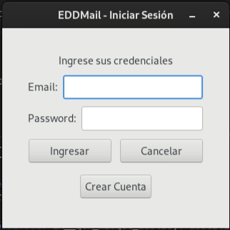

## 2. Carga del archivo JSON

- El usuario selecciona un archivo
  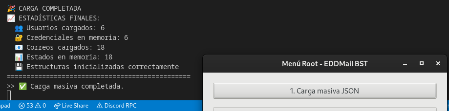

## 3. Menu de Usuario

- El usuario crea una cuenta o entra en su cuenta con su correo y su contraseña, luego de abrirse el menu puede elegir entre ver su bandeja de entrada, ver sus correos enviados a otras personas, redactar un correo a otra persona, ver la papelera de los correos a eliminar, programar la fecha de envio de un correo, ver su perfil y editar sus datos, y realizar los reportes.
  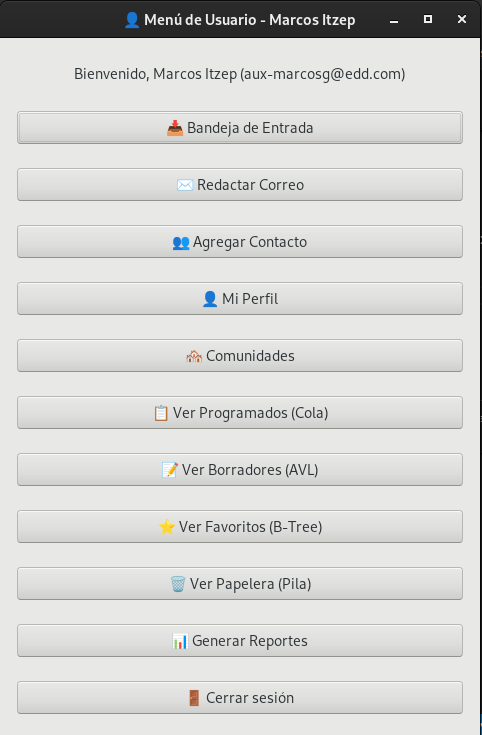

## 4. Interaccion de el menu

# Bandeja de Entrada

El usuario puede visualizar los correos recibidos.

Se muestran campos como estado (L o NL), asunto y remitente.

Puede:

Marcar un correo como leído.

Eliminarlo (se mueve a la pila de Papelera).

Ordenar correos por asunto (A-Z).

Ver la cantidad de correos no leídos.
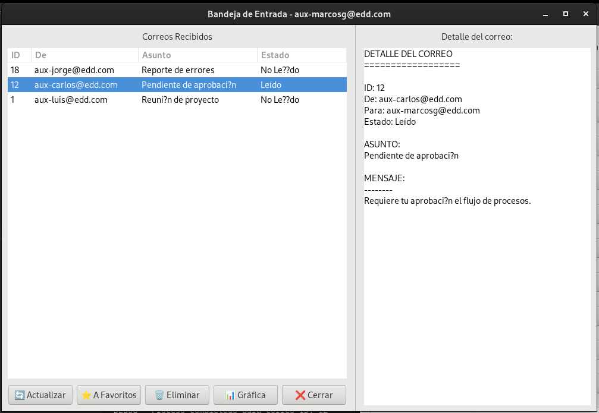

# Enviar Correo

Solo se pueden enviar correos a personas en la lista de contactos.

Si el destinatario no está en la lista → se muestra error.
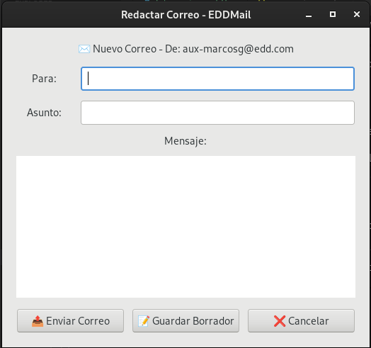

# Papelera

Contiene correos eliminados (almacenados en una pila).

Opciones:

Buscar un correo por palabra clave en el asunto.

Eliminar correos definitivamente.
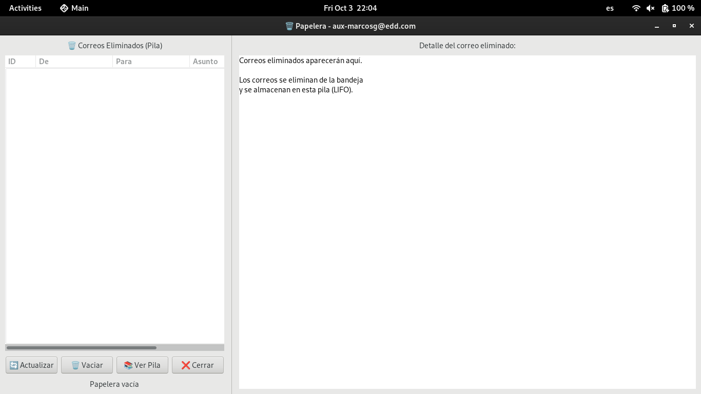

# Programar Correo

Similar al envío, pero permite definir fecha y hora de envío.

Los correos se almacenan en una cola (FIFO).
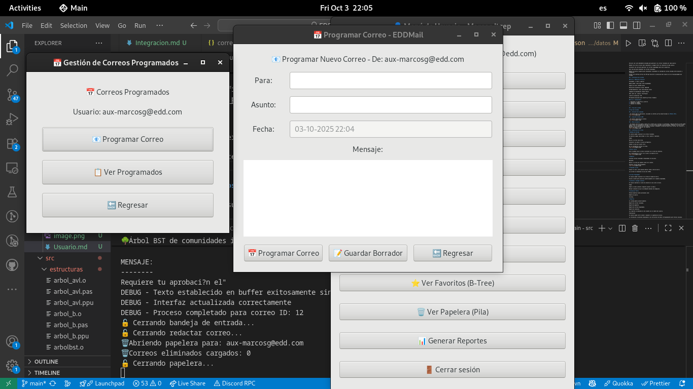

# Correos Programados

El usuario puede visualizar los correos en espera de envío.

Existe un botón para enviarlos automáticamente en el momento programado.
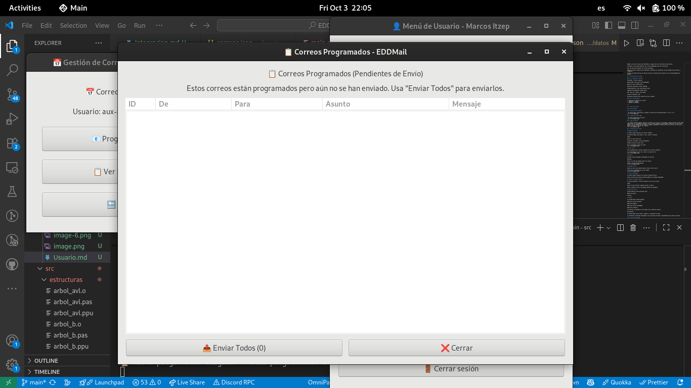

# Contactos y Agregar Contacto

El usuario mantiene su lista de contactos en una lista circular.

Puede:

Añadir un nuevo contacto (requiere conocer su email).

Revisar contactos uno por uno mediante botones de navegación.
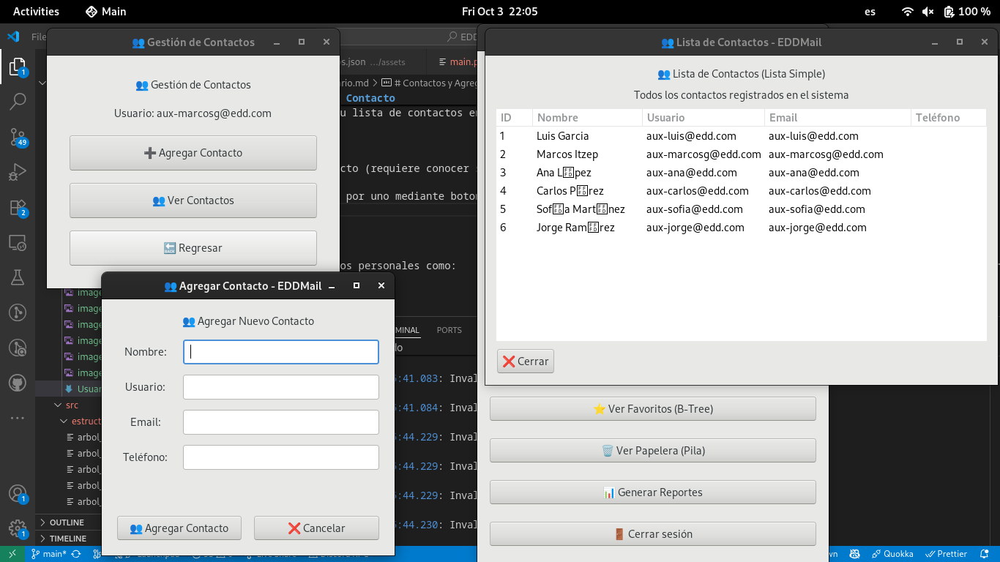

# Actualizar Perfil

Permite modificar datos personales como:

Nombre de usuario.

Teléfono.
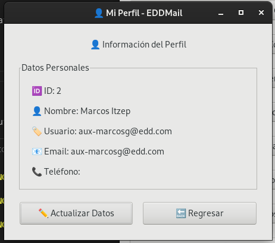

# Reportes

El sistema genera automáticamente:

Reporte de correos recibidos.

Reporte de papelera.

Reporte de correos programados.

Reporte de contactos.

Los reportes se almacenan en una carpeta con el nombre del usuario.

Finalización

El usuario puede cerrar sesión y regresar a la pantalla de inicio.

La información se mantiene almacenada en las estructuras de datos correspondientes para futuras sesiones.
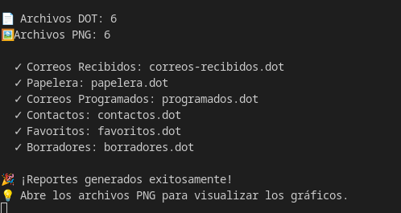

# Comunidades

El usuario puede comentar en las comunidades hechas por el usuario root
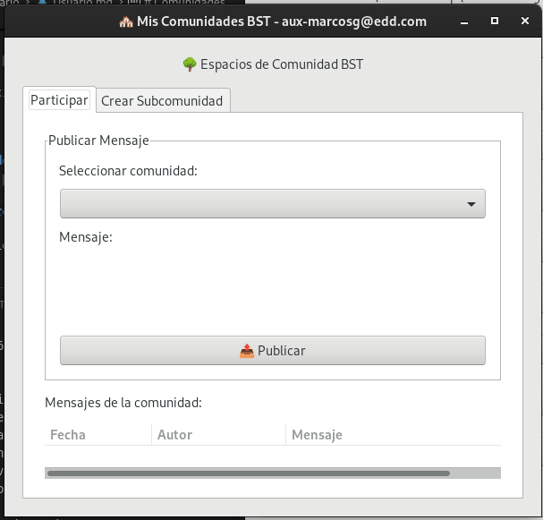

# Favoritos

El usuario desde la bandeja de entrada de los correos puede agregar correos a favoritos y los puede visualizar en el boton de ver favoritos
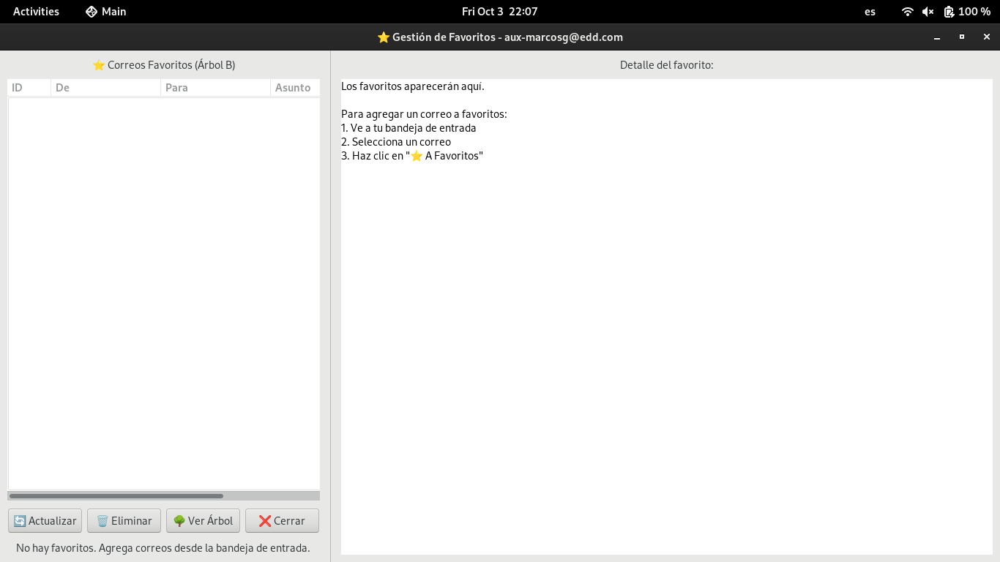

# Borradores

el usuario al redactar un correo puede agregarlo a borradores para poder seguir editandolo màs tarde, asi mismo puede enviarlo, editarlo, guardarlo y eliminarlo
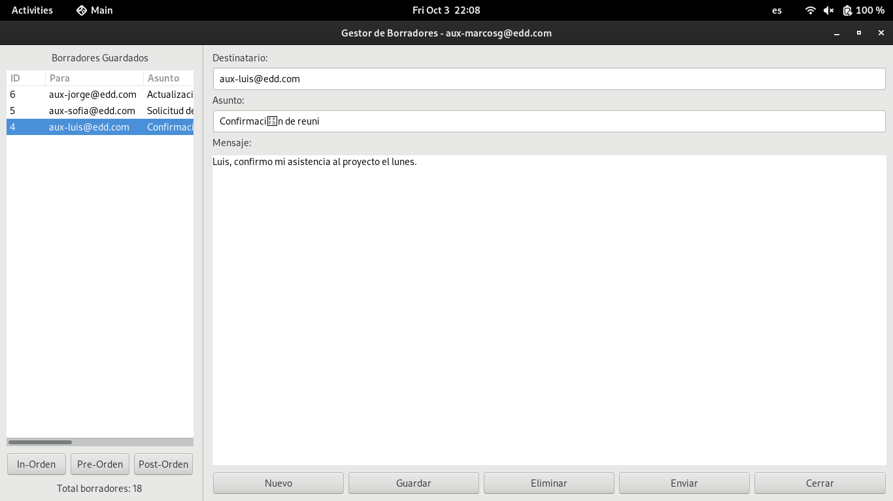

## 5. Cierre del programa

- El usuario puede cerrar la aplicación cuando haya terminado su análisis.
