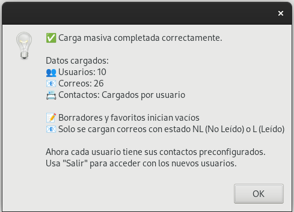
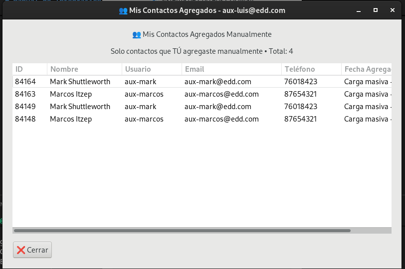
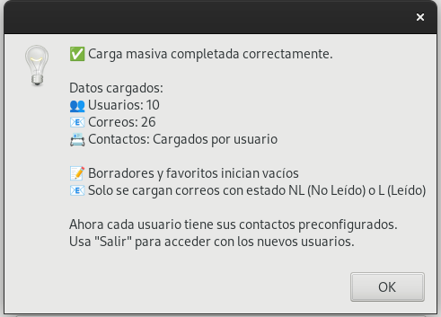
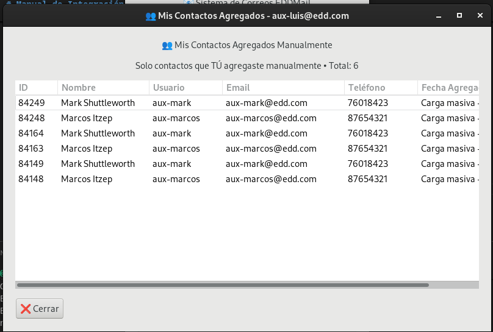
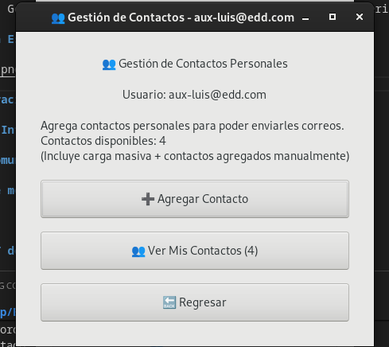
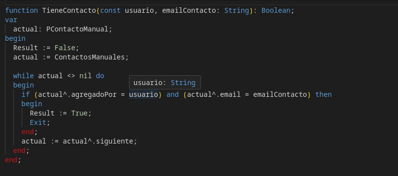
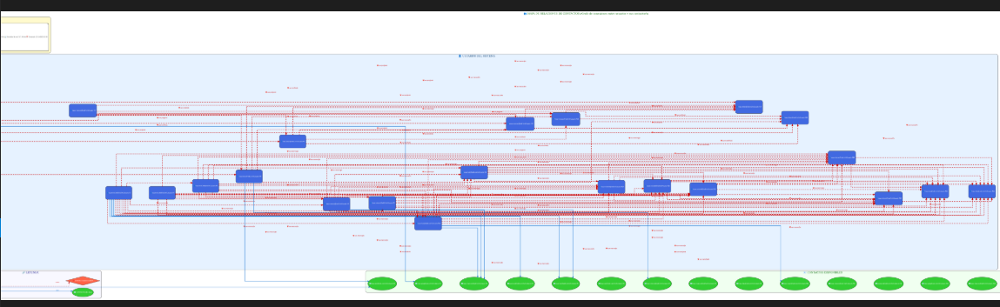
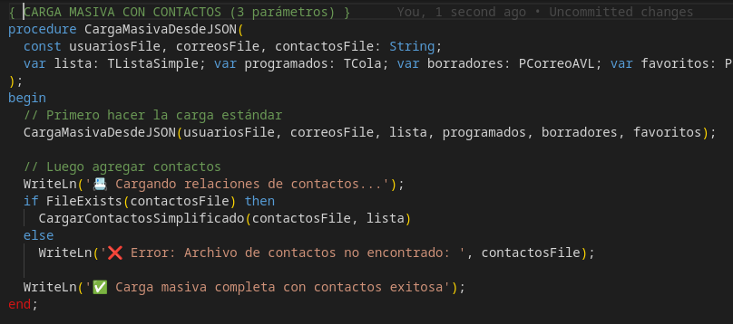
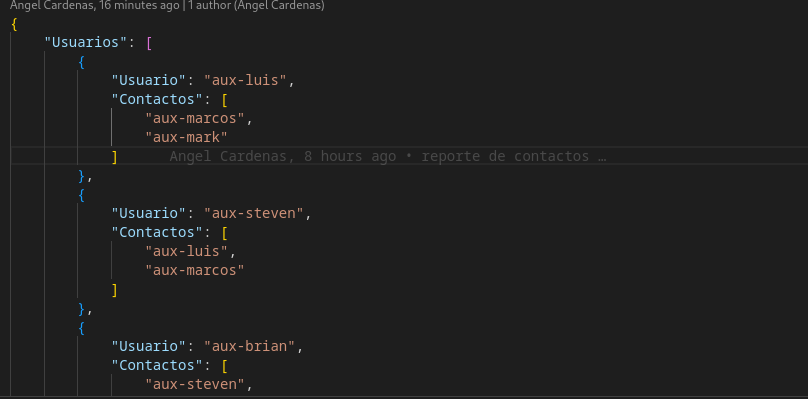

# Manual de Integración por Grupos

## Universidad San Carlos de Guatemala

_Facultad de Ingeniería_  
_Escuela de Ciencias y Sistemas_  
_Curso:_ Estructuras de Datos  
_Proyecto:_ EDDMail Fase 2

---

## Integrantes del Grupo

- Gabriela Alejandra Brito Pérez — Carnet: 202300686
- Angel Jose Cardenas Pocon — Carnet: 202304063
- Oliverio Abraham Caal Artola — Carnet: 202303864

---

## Objetivo de la Integración

Desarrollar la funcionalidad de comunidades en EDDMail, permitiendo que el usuario root cree comunidades y asigne usuarios a ellas. Cada uno de los usuarios puede tener varios contactos sin tener que cargarlos manualmente, aparte de poder manejar correos privados y el manejo de los correos por medio de la estructura blockchain

## Estructuras Utilizadas

- Blockchain: Registrará los correos que envien los usuarios en el sistema.
- Grafos no dirigidos (Integración por grupo): Representará la relación entre los usuarios y
  contactos que tenga. Cada nodo tendrá la siguiente información:
  ○ ID
  ○ Nombre
  ○ Usuario
- Compresión LZW: Reduce el tamaño del correo que se desea guardar optimizando
  almacenamiento.
- Árbol de Merkle: Gestionará los correos privados de cada usuario para verificar integridad

### Diagrama de la Estructura

# Manual de Integración por Grupos

## Capturas de la Interfaz

### Visualizacion de los contactos en la vista de un usuario

### Reporte de los contactos

## Integración en Cada Proyecto

### Alejandra Barrios

_Descripción:_  
Realizo la parte de la interfaz tanto para el usuario root como para el usuario normal, aplicando todas las variables necesarias para poder aplicar la interfaz en los demas proyectos, botones para mensajes, tablas para los mensajes, y la aplicacion de los programas para su propio proyecto.
_Captura:_

### Angel Cardenas

_Descripción:_  
Creo la generacion de reportes por medio de Graphviz, tambien la logica de la estructura de los grafos no dirigidos, mas el manejo de los codigos de las interfaces y de la estructura para el propio proyecto

### Oliverio Caal

_Descripción:_  
Creo el codigo necesario para añadir la carga masiva de los contactos junto con los usuarios y correos, todos estos en formato json para hacer valer lo necesario en el enunciado del proyecto

## Observaciones

- La integración se realizó utilizando el arbol BST y estructuras dinámicas en Object Pascal.
- El usuario root tiene privilegios para gestionar comunidades y realizar comentarios.
- Los reportes se generan en formato gráfico y se almacenan en la carpeta correspondiente.
- Las capturas muestran la estructura y la integración en cada proyecto individual.
- El sistema cumple con los requisitos del enunciado y la integración por grupos.
