## UNIVERSIDAD DE SAN CARLOS DE GUATEMALA

### FACULTAD DE INGENIERÍA

#### ESTRUCTURAS DE DATOS

#### CATEDRÁTICO: Ing. Alvaro Obrayan Hernandez

#### TUTOR ACADÉMICO: Luis Enrique Garcia

#### Angel José Cardenas Pocón

#### CARNÉ: 202304063

#### SECCIÓN: B

#### Guatemala, 24 de Octubre del 2025

# Manual Tecnico

## Introduccion

EDDMail es un sistema de simulación de correos electrónicos diseñado con fines académicos para la práctica de estructuras de datos dinámicas en Object Pascal, utilizando GTK como librería de interfaz gráfica.

El sistema permite la gestión completa de usuarios, envío y recepción de correos, programación de mensajes, administración de contactos y generación de reportes, todo soportado en estructuras como listas, colas, pilas y matrices dispersas.

## Objetivos

### Objetivo General

Implementar un sistema de simulación de correos electrónicos que integre diversas estructuras de datos dinámicas en un entorno gráfico, con el fin de administrar usuarios, correos y contactos de manera eficiente.

### Objetivos Específicos

- Diseñar e implementar una lista simple para el registro de usuarios.

- Utilizar una lista doblemente enlazada para la gestión de correos electrónicos recibidos.

- Implementar una lista circular para representar y recorrer los contactos de cada usuario.

- Emplear una cola para la administración de correos programados (FIFO).

- Incorporar una pila para almacenar y gestionar los correos eliminados.

- Construir una matriz dispersa que permita la visualización de relaciones entre emisores y receptores.

- Integrar una interfaz gráfica (GTK) que permita la interacción visual con las estructuras de datos y operaciones del sistema.

- Permitir al usuario root ejecutar operaciones avanzadas: carga masiva desde JSON y generación de reportes.

# Requisitos

### Requisitos de Hardware

Procesador: mínimo 1.5 GHz (recomendado 2.0 GHz o superior).

Memoria RAM: 2 GB mínimo (recomendado 4 GB o superior).

Almacenamiento: 500 MB de espacio disponible.

Pantalla: resolución mínima 1024x768.

### Requisitos de Software

Sistema Operativo: Linux (distribución libre).

Lenguaje de programación: Object Pascal.

IDE compatible: Lazarus o Free Pascal.

Librería gráfica: GTK.

Herramienta para gráficos y reportes: Graphviz.

Formato de integración de usuarios: Archivos JSON.

## Logica del programa

#### Carpeta

Fase 3 -> assets

- En esta carpeta se colocan los diferentes JSON para la prueba del programa en todo el transcurso de la creacion del mismo
  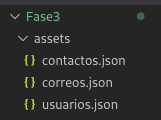

#### Carpeta

Fase 3 -> descargas

- En esta carpeta se colocan los correos que se descargan con la funcion de compresion LZW
  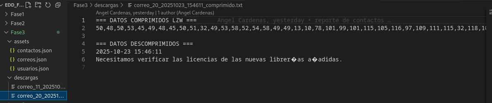

#### Carpeta

Fase 3 -> graficos

- Esta carpeta comprende todo el manejo y almacenamiento de los reportes, cada que se le da clic al boton de reportes depende de cada menu de usuario, se crean los reportes necesarios para esa misma visualizacion

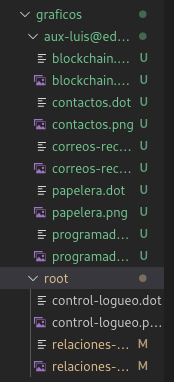
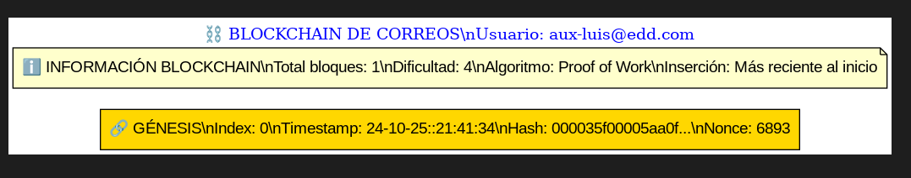

#### Carpeta

Fase 3 -> src -> estructuras

🔹 cola.pas, cola.o, cola.ppu

Rol en el sistema:
Implementa la cola (FIFO) para almacenar correos programados.

Lógica:

Los correos se encolan según la fecha/hora programada.

Se desencolan automáticamente cuando corresponde enviarlos.

🔹 comunidad.pas, comunidad.o, comunidad.ppu

Rol en el sistema:
Maneja las comunidades de usuarios, que agrupan varios usuarios en grupos definidos por el root.

Lógica:

Usa listas simples anidadas (lista de comunidades → lista de usuarios).

Permite asignar usuarios a comunidades ya creadas.

Da soporte a la integración grupal.

🔹 lista_simple.pas, lista_simple.o, lista_simple.ppu

Rol en el sistema:
Administra los usuarios registrados en el sistema.

Lógica:

Cada nodo representa un usuario (id, nombre, usuario, correo, teléfono).

Se insertan nuevos usuarios al registrarse o cargarse desde JSON.

El usuario root puede generar reportes a partir de esta lista.

🔹 arbol_avl.pas, arbol_avl.o, arbol_avl.ppu

Rol en el sistema:
Administra los correos marcados como borrador

Lógica:

Una estructura para almacenar correos.

Inserción, eliminación, búsqueda y actualización de correos.

Recorridos del árbol (inorden, preorden, postorden).

Rebalanceo automático para mantener eficiencia.

Operaciones personalizadas como filtrar por remitente

🔹 arbol_b.pas, arbol_b.o, arbol_b.ppu

Rol en el sistema:
Administra los correos marcados como favoritos

Lógica:

Insertar: Inserta un nuevo correo en el árbol

DividirHijo: Divide un nodo lleno y ajusta el árbol

Buscar: Busca un correo por su ID

Eliminar: Elimina un correo (solo en hojas, simplificado)

Mostrar: Imprime los nodos y claves del árbol por nivel

RecorridoInOrden: Recorre el árbol en orden y aplica una acción por cada correo

ContarCorreos: Devuelve la cantidad de correos en el árbol

LiberarArbol: Libera toda la memoria del árbol

🔹 arbolbst.pas, arbolbst.o, arbolbst.ppu

Rol en el sistema:
Administra las comunidades

Lógica:

InicializarBST: Prepara el árbol vacío.

InsertarComunidad: Inserta una comunidad ordenada por ID.

InsertarSubcomunidad: Inserta una subcomunidad como hijo de otra comunidad.

BuscarComunidadPorID: Busca comunidad por ID.

BuscarComunidadPorNombre: Busca por nombre (no usa orden).

EliminarComunidad: Elimina comunidad y sus mensajes.

PublicarMensaje: Agrega un mensaje a una comunidad.

MostrarMensajesComunidad: Lista todos los mensajes de una comunidad.

ContarComunidades: Cuenta nodos del árbol.

PuedeMostrarComunidad: Verifica permisos de visualización.

RecorridoPersonalizadoBST: Permite aplicar lógicas propias al recorrer el BST.

LiberarArbolBST: Libera toda la memoria del árbol y sus listas de mensajes.

🔹 matriz_dispersa.pas, matriz_dispersa.o, matriz_dispersa.ppu

Rol en el sistema:
Representa gráficamente la relación emisor ↔ receptor de correos.

Lógica:

Implementa una matriz dispersa (solo almacena celdas ocupadas).

Cada fila es un remitente, cada columna un destinatario.

Cada nodo registra el número de correos enviados.

Se puede graficar con Graphviz para visualizar conexiones.

🔹 pila.pas, pila.o, pila.ppu

Rol en el sistema:
Maneja la pila de correos eliminados.

Lógica:

Cuando un correo se borra de la bandeja de entrada, se apila en la papelera.

El usuario puede:

Buscar correos por palabra clave.

Eliminar definitivamente correos de la pila.

Estructura LIFO (el último eliminado es el primero en recuperarse o borrarse).

En conjunto, estos módulos conforman el núcleo lógico del programa:

- Usuarios → lista simple

- Papelera → pila

- Correos programados → cola

- Relaciones emisor-receptor → matriz dispersa

- Favoritos → arbol B

- Borradores → arbol AVL

- Comunidades → arbol BST

🔹 blockchain.pas, blockchain.o, blockchain.ppu

Inicialización

InicializarBlockchain: crea una blockchain vacía y genera el bloque génesis (primer bloque).

CrearBloqueGenesis: inserta un bloque inicial con datos del sistema (SISTEMA → GENESIS).

🔹 Inserción de correos

RegistrarCorreoEnBlockchain: recibe los datos de un correo y los inserta como un nuevo bloque.

InsertarBloque: agrega el nuevo bloque al inicio de la cadena (más reciente primero).

CrearNuevoBloque: construye un bloque con el correo, calcula su hash y nonce mediante Proof of Work.

🔹 Hashing y minería

HashSimple: algoritmo propio que simula un hash tipo SHA-256 con operaciones aritméticas y XOR.

ProofOfWork: busca un nonce que haga que el hash del bloque comience con cierta cantidad de ceros (según la dificultad).

CalcularHash y CalcularHashData: generan el hash del bloque y de los datos del correo, respectivamente.

🔹 Verificación

ValidarBloque: comprueba que el bloque tenga el hash correcto y cumpla la dificultad.

ValidarBlockchain: recorre toda la cadena asegurando que los enlaces entre bloques sean válidos.

🔹 Utilidades

MostrarBlockchain: imprime en consola el contenido completo de la cadena.

BuscarCorreoEnBlockchain: busca un bloque específico por ID de correo.

ListarCorreosPorRemitente: muestra todos los correos enviados por un usuario.

ContarBloquesBlockchain: retorna el total de bloques.

LiberarBlockchain: libera la memoria ocupada por todos los bloques.

🔹 merkle_tree.pas, merkle_tree.o, merkle_tree.ppu

Integración con tus archivos JSON actuales
(por ejemplo, cargar los correos de correos.json e insertarlos automáticamente en el árbol Merkle).

Mejorar o depurar el código (por ejemplo, implementar eliminación real, optimizar el cálculo de hash o evitar recalcular todo el árbol en inserciones grandes).

Generar un ejemplo práctico completo (un programa principal en Pascal que use este unit, lea los JSON y muestre el Merkle Tree por consola o genere el .dot).

Modificar la salida visual (por ejemplo, personalizar el .dot o generar directamente un .png desde Graphviz).

Añadir más campos o validaciones (como estados de correos, cifrado del mensaje, o relación con usuarios del JSON).

(algunos ejemplos de las estructuras)

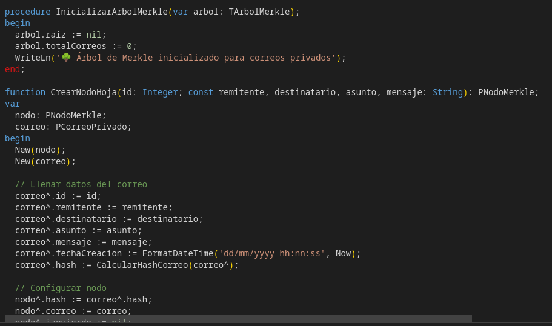
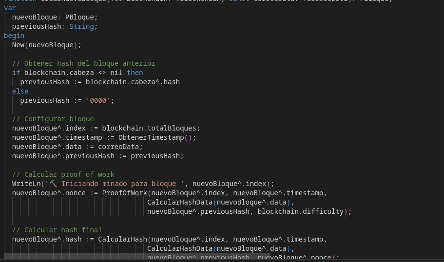
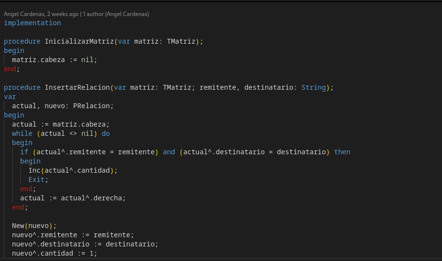

#### Carpeta

Fase 3 -> src -> ui

- Esta carpeta comprende la interfaz de todo el programa
  🔹 login.pas

Rol: Pantalla inicial del sistema.

Lógica:

Permite iniciar sesión con credenciales (usuario estándar o root).

También da la opción de registrar un nuevo usuario.

Valida datos contra la lista simple de usuarios.

🔹 menu_root.pas

Rol: Menú principal del usuario root.

Lógica:

Funcionalidades especiales:

Carga masiva de usuarios desde un JSON.

Generación de reportes (usuarios, relaciones).

Navegación hacia otras vistas de administración.

🔹 menu_usuario.pas

Rol: Menú principal de un usuario estándar.

Lógica:

Desde aquí el usuario puede acceder a:

Bandeja de entrada.

Papelera.

Redactar correo.

Programar correo.

Contactos.

Perfil.

Reportes.

🔹 registro_usuario.pas

Rol: Pantalla de registro.

Lógica:

Captura datos de nuevos usuarios (id, nombre, correo, teléfono).

Inserta el usuario en la lista simple.

Valida que no se repitan correos/usuarios.

🔹 perfil.pas

Rol: Interfaz para actualizar información del usuario.

Lógica:

Permite cambiar el nombre de usuario o número de teléfono.

Se actualizan los nodos correspondientes en la lista simple.

🔹 bandeja.pas

Rol: Bandeja de entrada del usuario.

Lógica:

Muestra correos de la lista doble.

Funciones:

Marcar correos como leídos.

Eliminar (se mandan a la pila de papelera).

Ordenar correos por asunto (A-Z).

Mostrar contador de no leídos.

🔹 borradores.pas

Rol: Muestra los correos marcados como borradores

Lógica:

Interfaz gráfica: GTK2 (ventana con paneles, listas, campos)

Almacenamiento: Árbol AVL (PCorreoAVL)

Programados: Cola FIFO (TCola)

Selección y edición: Vía campos conectados al árbol AVL

Acciones: Crear, editar, eliminar, enviar

Recorridos del árbol: Inorden, preorden, postorden (en consola)

🔹 redactar.pas

Rol: Ventana para escribir un correo.

Lógica:

Solo permite enviar correos a contactos existentes en la lista circular.

Valida que el destinatario esté agregado.

Inserta el correo en la bandeja del destinatario.

🔹 programar_correo.pas

Rol: Interfaz para programar correos.

Lógica:

Similar a redactar, pero con fecha/hora de envío.

Los correos se encolan en la cola.

Incluye botón para ejecutar el envío programado.

🔹 papelera.pas

Rol: Ventana de correos eliminados.

Lógica:

Muestra los correos almacenados en la pila.

Funciones:

Buscar por palabra clave.

Eliminar definitivamente (desapilar).

🔹 agregar_contacto.pas

Rol: Pantalla para añadir contactos.

Lógica:

Solicita el correo electrónico del contacto.

Inserta en la lista circular de contactos del usuario.

🔹 contacto.pas

Rol: Visualización de contactos individuales.

Lógica:

Permite recorrer los contactos uno por uno con botones de navegación.

🔹 comunidades.pas

Rol: Gestión de comunidades desde la vista de root.

Lógica:

Crear comunidades.

Asignar usuarios a las comunidades.

Un usuario puede estar en varias.

🔹 correos_privados.pas

MostrarCorreosPrivados → Crea y muestra la ventana.

CargarPrivadosEnLista → Pide los correos del usuario desde el Merkle Tree.

OnSeleccionarPrivado → Muestra detalles de un correo.

OnGenerarReporteMerkle → Exporta un gráfico DOT/PNG del árbol.

AgregarCorreoAPrivados → Inserta un nuevo correo protegido por Merkle.

🔹 blockchain_viewer.pas
Ventana principal (BlockchainWindow)

Título: “Blockchain EDD-Mail Viewer”.

Tamaño: 1400x800.

División en dos paneles (gtk_hpaned_new):

Izquierdo: lista de bloques + botones + información.

Derecho: detalle del bloque seleccionado.

Crea la tabla (GtkTreeView) con columnas:

INDEX, TIMESTAMP, DE, PARA, ASUNTO, HASH, NONCE.

Agrega botones:

- Actualizar

- Validar

- Reporte

- Consola

- Cerrar

Carga los bloques con CargarBloquesEnLista.

Muestra mensaje inicial en el cuadro de texto:

“Esta blockchain registra todos los correos enviados en el sistema…”

Finalmente, llama a:

gtk_widget_show_all(BlockchainWindow);

para mostrar toda la interfaz al usuario.

- En conclusión, la carpeta ui/ contiene todas las pantallas gráficas, que funcionan como puentes entre el usuario y las estructuras de datos implementadas en la carpeta estructuras/.

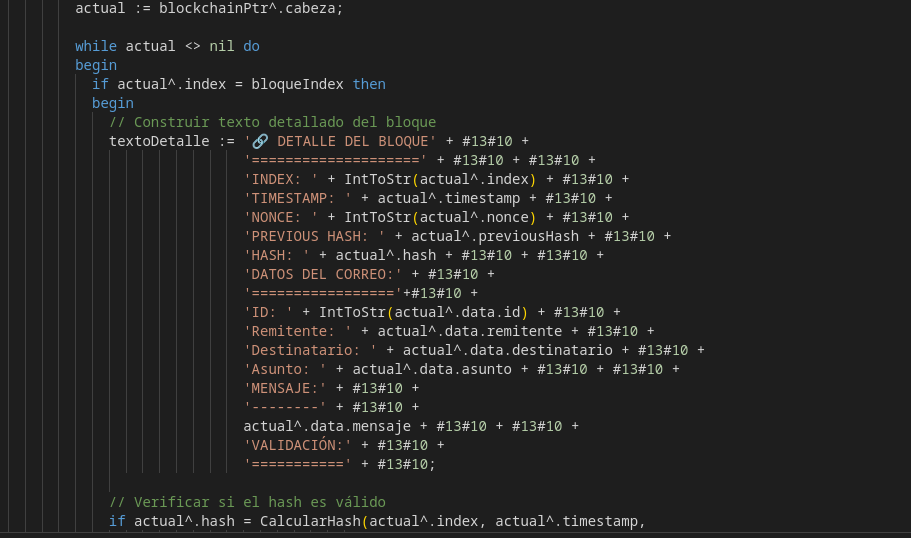
(algunos ejemplos de esta carpeta)
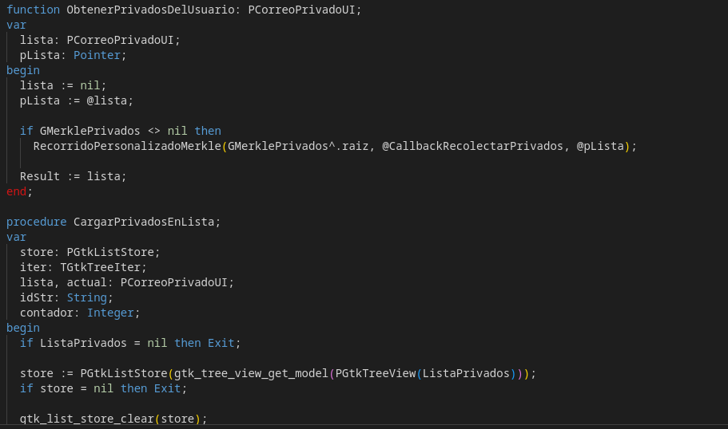
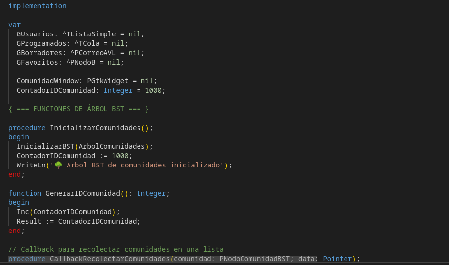
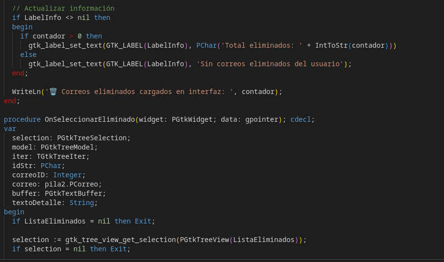
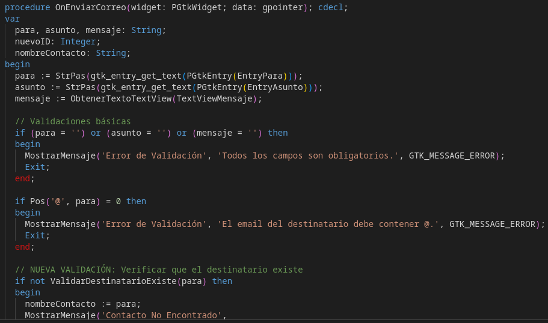

#### Carpeta

Fase 3 -> src -> utils

🔹 reports.pas

Rol: Interfaz para generación y visualización de reportes.

Lógica:

Genera reportes en carpetas específicas (ej. usuario-reportes/).

Tipos:

Correos recibidos.

Papelera.

Correos programados.

Contactos.

Comunidades.

Relaciones remitente-destinatario (matriz dispersa).

🔹 json_loader.pas

Rol: Módulo de lectura de archivos JSON.

Lógica:

Implementa la carga masiva de usuarios desde un archivo JSON.

Convierte la información en nodos de la lista simple de usuarios.

Es utilizado principalmente por el usuario root.

Valida campos como id, nombre, usuario, email, telefono.

Tambien empieza a cargar masivamente los contactos en esta nueva fase, no solamente los correos y los usuarios

🔹 control_login.pas

RegistrarEntrada Inserta nueva sesión activa Lista enlazada (inicio)

RegistrarSalida Marca sesión como cerrada Recorre lista

ExportarLoginJSON Convierte todos los registros a JSON Recorre lista completa

LiberarControlLogin Libera toda la memoria Iterativa

InicializarControlLogin Prepara el sistema Inicialización

🔹 lzw_compression.pas

InicializarDiccionario Crea el diccionario base ASCII Interno

BuscarEnDiccionario Busca cadena → código Interno

BuscarCodigoDiccionario Busca código → cadena Interno

AgregarADiccionario Añade una nueva secuencia al diccionario Interno

ComprimirLZW Comprime un texto a secuencia de códigos Principal

DescomprimirLZW Reconstruye texto desde códigos Principal

StringToBytes / BytesToString Conversiones binarias Auxiliares

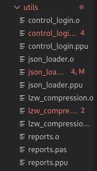

(algunos ejemplos de esta carpeta)
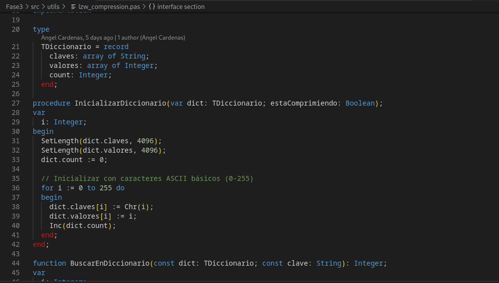
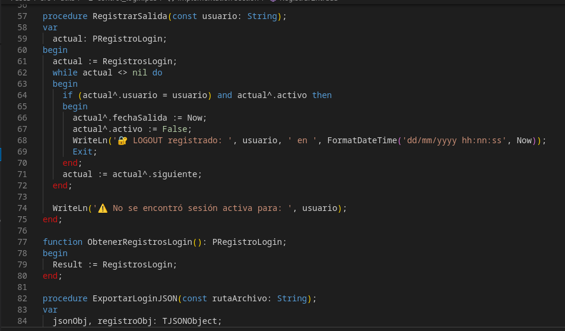

#### Metodo main

- Este archivo comprende lo primero que se ejecuta al compilar el programa, se inicializan todas las variables globales y luego se muestra la primera ventana que es la que inicia todo el programa, la ventana de login.
  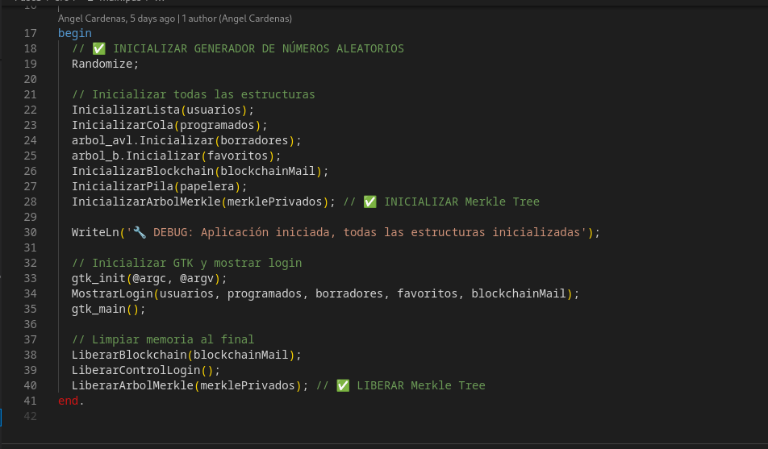
